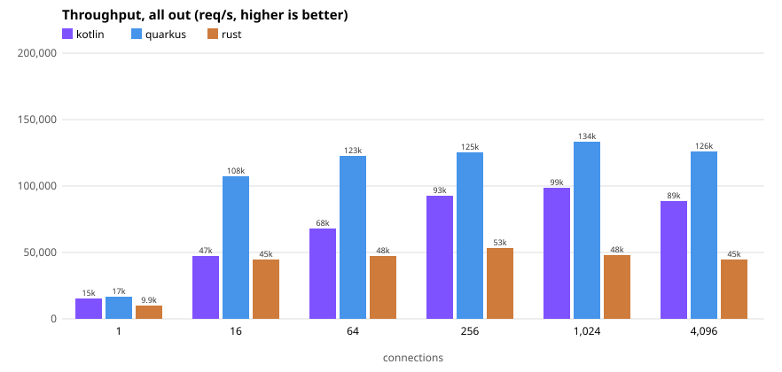
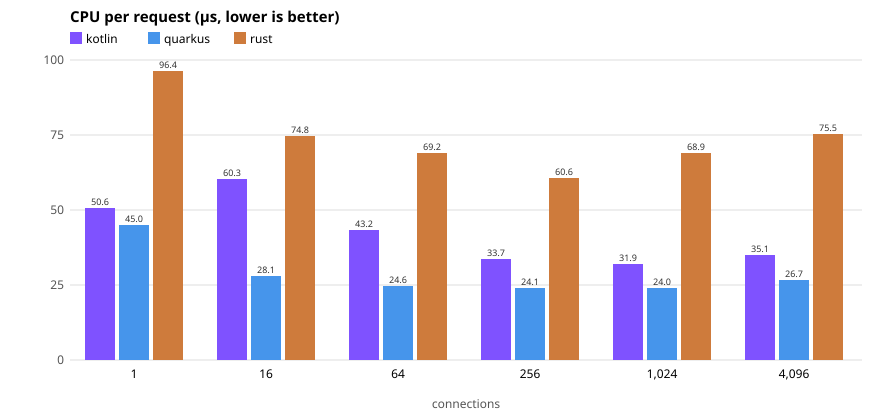
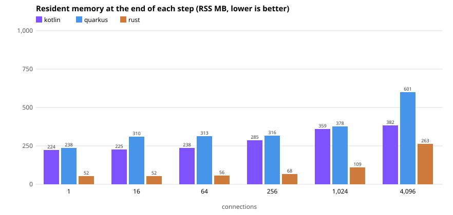

# Results on the reference machine

AMD Ryzen 9 7950X (2 NUMA nodes of 8 cores, SMT), every CPU fixed at 4.3 GHz, boost off, Linux 7.1.
Each app on 4 physical cores (CPUs 1-4, one thread per core), Hyperfoil on 8 cores of the other node
(CPUs 8-15), the ports built from the commits in `upstream/`, unmodified. Produced from a fresh clone
with:

```sh
./bench.sh setup && ./bench.sh parity quarkus && ./bench.sh parity kotlin   # 43 checks, 0 different, each
./bench.sh run                                                             # the article matrix, all out
```

Data: [`runs/20261013-143448-4c/`](runs/20261013-143448-4c/) (`config.txt` has every setting, the
JVM options and the commits; `report.txt` is the output of `./bench.sh report` on it).

## All out, 4 cores (medians of 3 reps)







The same data, as numbers:

| conns | Kotlin req/s | Quarkus req/s | Rust req/s | Quarkus / Kotlin | µs CPU/req K / Q / R | p99 ms K / Q / R | RSS MB K / Q / R |
|---:|---:|---:|---:|---:|---:|---:|---:|
| 1 | 15,006 | 16,710 | 9,910 | 111% | 50.6 / 45.0 / 96.4 | 0.1 / 0.1 / 0.1 | 224 / 238 / 52 |
| 16 | 47,119 | 107,621 | 44,572 | 228% | 60.3 / 28.1 / 74.8 | 0.8 / 0.8 / 0.7 | 225 / 310 / 52 |
| 64 | 67,734 | 122,526 | 47,507 | 181% | 43.2 / 24.6 / 69.2 | 2.0 / 2.7 / 2.6 | 238 / 313 / 56 |
| 256 | 92,898 | 125,021 | 53,145 | 135% | 33.7 / 24.1 / 60.6 | 6.3 / 5.3 / 8.5 | 285 / 316 / 68 |
| 1024 | 98,640 | 133,580 | 48,048 | 135% | 31.9 / 24.0 / 68.9 | 16.5 / 13.5 / 41.7 | 359 / 378 / 109 |
| 4096 | 88,841 | 125,983 | 44,971 | 142% | 35.1 / 26.7 / 75.5 | 58.7 / 53.2 / 331.4 | 382 / 601 / 263 |

- **Quarkus serves the most requests at every connection count**, with the least CPU per request.
- **It also uses more memory than Kotlin at every connection count**, most at 4,096 (601 vs 382 MB):
  more heap per connection and more garbage collection at many connections, in
  [NOTES.md](../NOTES.md), "Many connections".
- **Rust is the unmodified port**: its listen backlog is 128, and at 1,024 and 4,096 connections the
  kernel dropped 75-3,650 connection attempts per step before they were accepted (retried, so every
  connection opened). The Kotlin article measured Rust with a patch for this; this repository changes
  no port's code ([DIFFERENCES.md](../DIFFERENCES.md)).
- Every app passed the smoke test before every measurement, and no step had client errors, missing
  connections, error lines in an app's log, waits for a connection in the measured phase, or a
  saturated load driver.

**Why Quarkus slows down, and grows, with many connections.** From 1,024 to 4,096 connections its
throughput drops 6% and its memory rises from 378 to 601 MB. What the investigation measured
([NOTES.md](../NOTES.md), "Many connections", at 2 cores up to 16,384 connections):

- **Every open connection keeps objects alive**: about 11 KB of heap each (Netty's and Vert.x'
  per-connection state, buffers), about 200 MB at 16,384 connections, for as long as they stay open.
  That was measured before one fix: 4.7 KB of it was a Vert.x queue per connection, removed here by
  Vert.x's strict thread mode and reported upstream
  ([eclipse-vertx/vert.x#6429](https://github.com/eclipse-vertx/vert.x/issues/6429)).
- **The garbage collector pays for them on every young collection**: it has to scan the old
  generation's cards that point into the young one, and that scan grew from 0.3 to 6.4 µs per
  request between 1,024 and 16,384 connections (CPU profile; [flame graphs](#where-the-time-goes)).
  Full collections happened too, but cost far less CPU (1.9% of the samples).
- **The heap is capped at 512 MB for both JVMs** (`-Xmx512m`), and Quarkus runs with the UBI image's
  options that return memory to the OS (`MaxHeapFreeRatio=20`, `GCTimeRatio=4`). With 200 MB of live
  connection state that leaves little room, so collections come more often: an inference, not a
  measured comparison. We did not tune the heap per core count or per connection count, on purpose;
  a bigger heap, or a collector without a card table, are open questions for the challenge.

**Repeatability.** An earlier full run of the same matrix the same afternoon (not kept) agreed within
3% at every connection count, e.g. Quarkus 133,823 and Kotlin 100,998 req/s at 1,024 connections.

**The fixed-rate phase** (`--rate`): this run also started it, and it was stopped after 13 of its 48
steps, all with their measured phase, as a check that it works. Those numbers are not part of these
results.

## Where the time goes

CPU flame graphs at 1,024 connections, 4 cores (`./bench.sh profile --app ... --conns 1024`; open in a
browser): [Quarkus](flamegraphs/quarkus-4c-1024conns-cpu.html), [Kotlin](flamegraphs/kotlin-4c-1024conns-cpu.html).
Each is 10 s of async-profiler at one sample per millisecond of CPU, with `-XX:+DebugNonSafepoints`
so that inlined code is attributed to the right frame: a frame's sample count is its CPU time in
milliseconds.

From the investigation, 2 cores, Quarkus at 1,024 and 16,384 connections: how young-GC card scanning
grows with the number of connections ([NOTES.md](../NOTES.md)):
[1,024](flamegraphs/quarkus-2c-1024conns-cpu.html), [16,384](flamegraphs/quarkus-2c-16384conns-cpu.html).

## Earlier measurements

[RESULTS.md](../RESULTS.md) keeps the measurements of the investigation (2 and 4 cores, earlier
designs, the previous harness with the verification loadgen and oha), with the data in [`data/`](data/).
